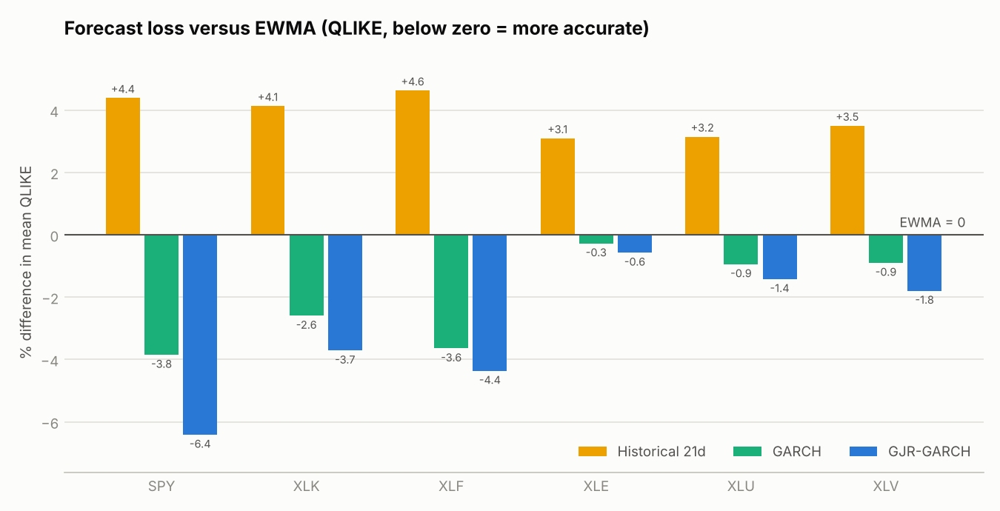
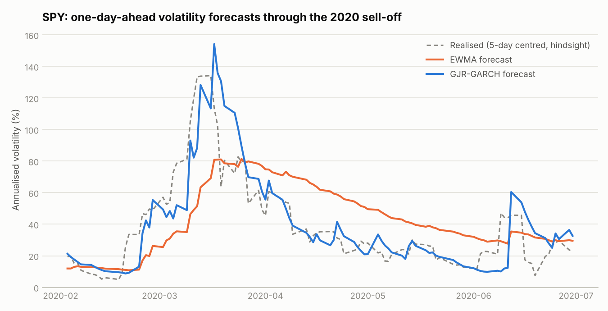
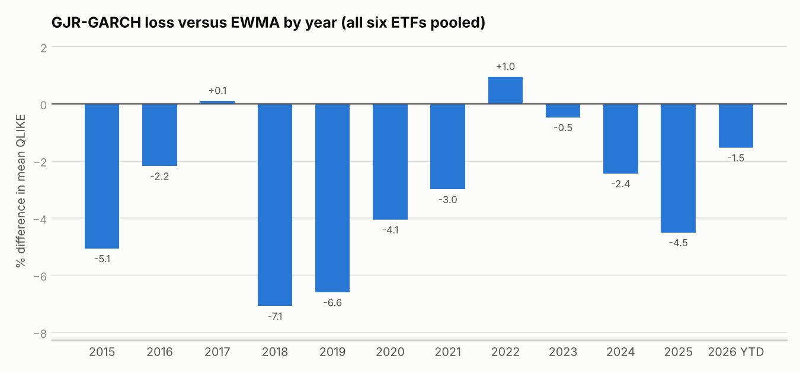
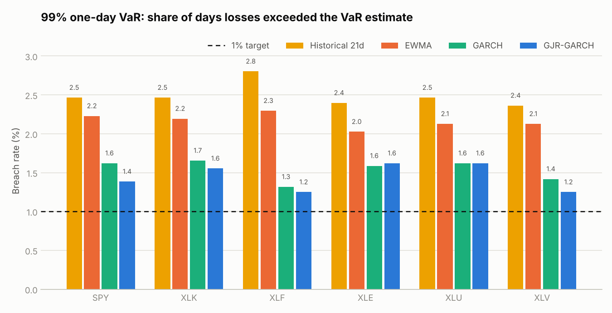

# Volatility Forecasting: GARCH vs EWMA on US Equity ETFs

Does a GARCH model forecast daily volatility better than the simpler methods used in practice, and does the answer hold across sectors and through stress periods?

This project tests four one-day-ahead volatility models on SPY and five sector ETFs over almost 12 years of out-of-sample data. It scores each model on forecast accuracy and on how well its 99% Value at Risk estimate holds up.

## Key findings

Out-of-sample period: 2 January 2015 to 13 October 2026, 2,962 trading days per ETF.

- **GJR-GARCH was the most accurate model on all six ETFs**, with QLIKE loss 0.6% to 6.4% below EWMA. The difference is significant at the 5% level for SPY, XLF and XLU, at 10% for XLK and XLV, and not significant for XLE.
- **EWMA beat a 21-day rolling window on every ETF** (Diebold-Mariano p ≤ 0.001), so even the simplest weighting of recent data adds value.
- **Allowing for asymmetry mattered most for the broad market.** For SPY, the estimated GJR-GARCH reaction to up days is essentially zero; almost all of the variance response comes from down days.
- **The advantage depends on the regime.** Pooled across ETFs, GJR-GARCH beat EWMA in 10 of 12 years. The exceptions were 2017 (+0.1%) and 2022 (+1.0%). A likely reason: GARCH pulls forecasts back toward a long-run average, which helps after short spikes like March 2020 but works against it when volatility stays high for months, as it did through the 2022 rate shock.
- **Normal-distribution VaR badly understates tail risk.** EWMA and historical VaR were breached on 2.0% to 2.8% of days against a 1% target, failing the Kupiec test on every ETF. Student-t GARCH models cut breaches by about a third (257 for GJR-GARCH against 385 for EWMA, pooled) but still ran at 1.25% to 1.62%. GJR-GARCH passed the Kupiec test only for XLF and XLV.

## Data

Daily adjusted closing prices from Yahoo Finance (via `yfinance`) for 4 January 2010 to 13 October 2026:

| Ticker | Exposure |
|---|---|
| SPY | S&P 500 |
| XLK | Technology |
| XLF | Financials |
| XLE | Energy |
| XLU | Utilities |
| XLV | Health care |

Returns are daily log returns in percent. Adjusted prices include dividends, so returns are total returns. The downloaded prices are saved in `data/prices.csv` so the results can be reproduced exactly.

## Models

Each model forecasts tomorrow's variance $\sigma^2_{t+1}$ using returns up to and including today, $r_t$.

| Model | Forecast | Notes |
|---|---|---|
| Historical 21d | sample variance of the last 21 returns | Equal weight on the past month, zero weight before |
| EWMA | $\sigma^2_{t+1} = \lambda\sigma^2_t + (1-\lambda)r_t^2$ | RiskMetrics, $\lambda = 0.94$. Nothing is estimated |
| GARCH(1,1) | $\sigma^2_{t+1} = \omega + \alpha r_t^2 + \beta\sigma^2_t$ | The $\omega$ term gives a long-run level that forecasts revert to |
| GJR-GARCH(1,1,1) | $\sigma^2_{t+1} = \omega + (\alpha + \gamma\,\mathbb{1}_{r_t<0})\,r_t^2 + \beta\sigma^2_t$ | Adds $\gamma$, an extra reaction to falling markets |

EWMA is a special case of GARCH with $\omega = 0$ and $\alpha + \beta = 1$. That restriction is what the comparison tests: whether estimating the parameters and allowing mean reversion is worth it.

Both GARCH models assume Student-t errors and zero mean, and are fitted by maximum likelihood with the [`arch`](https://github.com/bashtage/arch) package.

### Rolling out-of-sample design

- GARCH models are re-estimated every 21 trading days on the previous 1,000 days of returns (about four years).
- Between refits the parameters stay fixed, but the variance updates every day with the newest return.
- Every forecast uses only data available at the close of the day before. A unit test reruns the backtest on truncated data and confirms the forecasts are identical, so nothing from the future leaks in.

### What the estimated parameters say (GJR-GARCH, median across refits)

| ETF | α (up and down days) | γ (extra for down days) | β | Persistence | Shock half-life (days) | t degrees of freedom |
|---|---|---|---|---|---|---|
| SPY | 0.000 | 0.331 | 0.805 | 0.986 | 47 | 7.3 |
| XLK | 0.000 | 0.258 | 0.834 | 0.977 | 29 | 8.2 |
| XLF | 0.035 | 0.259 | 0.803 | 0.946 | 13 | 7.7 |
| XLE | 0.010 | 0.079 | 0.938 | 0.989 | 62 | 8.8 |
| XLU | 0.026 | 0.060 | 0.909 | 0.971 | 23 | 8.8 |
| XLV | 0.003 | 0.166 | 0.875 | 0.968 | 21 | 8.9 |

Persistence is $\alpha + \gamma/2 + \beta$; the half-life is how many days it takes a volatility shock to fade by half. The leverage effect ($\gamma$) is strong for SPY, tech and financials and weak for energy and utilities, which matches where GJR-GARCH gained most over plain GARCH.

## How forecasts are scored

The true daily variance is never observed, so each forecast is compared with the next day's squared return, a noisy but unbiased stand-in.

- **QLIKE loss**, $\frac{r^2}{\sigma^2} - \log\frac{r^2}{\sigma^2} - 1$, is the main measure. Patton (2011) shows it still ranks models correctly with a noisy proxy, and it is less dominated by a few extreme days than squared error. Days with a return of exactly zero (6 to 34 per ETF) are excluded because QLIKE is undefined there.
- **Diebold-Mariano tests** check whether the difference in average loss between two models is statistically significant, using Newey-West standard errors.
- **99% one-day VaR backtest.** Each model's VaR is its volatility forecast times the 1% quantile of its error distribution (normal for Historical and EWMA, fitted Student-t for the GARCH models). A breach is a day when the loss was larger than the VaR. The Kupiec test checks whether breaches happen on 1% of days, and the Christoffersen test checks whether they cluster.

## Results

### Forecast accuracy

Mean QLIKE relative to EWMA (negative means more accurate than EWMA), with Diebold-Mariano statistics:

| ETF | Historical 21d | GARCH | GJR-GARCH | DM: GJR-GARCH vs EWMA (p) | DM: GJR-GARCH vs GARCH (p) |
|---|---|---|---|---|---|
| SPY | +4.4% | -3.8% | **-6.4%** | -3.27 (0.001) | -1.95 (0.051) |
| XLK | +4.1% | -2.6% | **-3.7%** | -1.94 (0.052) | -0.74 (0.462) |
| XLF | +4.6% | -3.6% | **-4.4%** | -2.60 (0.009) | -0.51 (0.611) |
| XLE | +3.1% | -0.3% | **-0.6%** | -0.72 (0.471) | -0.51 (0.610) |
| XLU | +3.2% | -0.9% | **-1.4%** | -2.27 (0.024) | -1.83 (0.068) |
| XLV | +3.5% | -0.9% | **-1.8%** | -1.66 (0.097) | -1.49 (0.137) |

On mean squared error the GARCH models were 3% to 16% better than EWMA on every ETF.





In March 2020, GJR-GARCH reacted to the sell-off within a day and then let its forecast fall back as markets calmed. EWMA moved up more slowly and stayed high well into May.



### Value at Risk

99% one-day VaR breaches (expected: about 30 per ETF, 1%):

| ETF | Historical 21d | EWMA | GARCH | GJR-GARCH | GJR-GARCH Kupiec p | GJR-GARCH Christoffersen p |
|---|---|---|---|---|---|---|
| SPY | 73 (2.46%) | 66 (2.23%) | 48 (1.62%) | 41 (1.38%) | 0.047 | 0.131 |
| XLK | 73 (2.46%) | 65 (2.19%) | 49 (1.65%) | 46 (1.55%) | 0.005 | 0.746 |
| XLF | 83 (2.80%) | 68 (2.30%) | 39 (1.32%) | 37 (1.25%) | 0.190 | 0.088 |
| XLE | 71 (2.40%) | 60 (2.03%) | 47 (1.59%) | 48 (1.62%) | 0.002 | 0.008 |
| XLU | 73 (2.46%) | 63 (2.13%) | 48 (1.62%) | 48 (1.62%) | 0.002 | 0.806 |
| XLV | 70 (2.36%) | 63 (2.13%) | 42 (1.42%) | 37 (1.25%) | 0.190 | 0.487 |

Historical and EWMA VaR fail the Kupiec test on every ETF (p < 0.001). GJR-GARCH breaches do not cluster for five of six ETFs (Christoffersen p > 0.05), the exception being energy.



## Limitations and next steps

- **Noisy target.** Squared daily returns are a rough measure of true variance. Intraday realised volatility would give a sharper comparison.
- **One-day horizon only.** Regulatory and risk reporting often uses 10-day VaR, where mean reversion matters more.
- **Tails are still too thin.** Even with Student-t errors, GARCH VaR is breached more often than it should be. Filtered historical simulation or extreme value theory for the tail are the natural next steps.
- **Limited universe.** Six US equity ETFs. Single stocks, rates and FX may behave differently.

## How to run

```bash
pip install -r requirements.txt
python run.py            # uses data/prices.csv; about a minute
python run.py --refresh  # re-download prices from Yahoo Finance first
python -m pytest         # unit tests
```

## Project structure

```
run.py                     full study: backtest, scoring, tables, figures
src/volforecast/
    data.py                download and prepare returns
    models.py              historical, EWMA and rolling GARCH forecasts
    backtest.py            runs every model on every ETF over the same days
    evaluate.py            QLIKE, MSE, Diebold-Mariano, Kupiec, Christoffersen
    plots.py               figures
tests/test_core.py         unit tests, including a look-ahead check
data/prices.csv            cached prices used for the results above
results/                   forecasts, parameters, result tables and figures
```

## References

- Bollerslev, T. (1986). Generalized autoregressive conditional heteroskedasticity. *Journal of Econometrics*, 31(3).
- Glosten, L., Jagannathan, R. and Runkle, D. (1993). On the relation between the expected value and the volatility of the nominal excess return on stocks. *Journal of Finance*, 48(5).
- J.P. Morgan/Reuters (1996). *RiskMetrics Technical Document*, 4th edition.
- Patton, A. (2011). Volatility forecast comparison using imperfect volatility proxies. *Journal of Econometrics*, 160(1).
- Diebold, F. and Mariano, R. (1995). Comparing predictive accuracy. *Journal of Business and Economic Statistics*, 13(3).
- Kupiec, P. (1995). Techniques for verifying the accuracy of risk measurement models. *Journal of Derivatives*, 3(2).
- Christoffersen, P. (1998). Evaluating interval forecasts. *International Economic Review*, 39(4).
